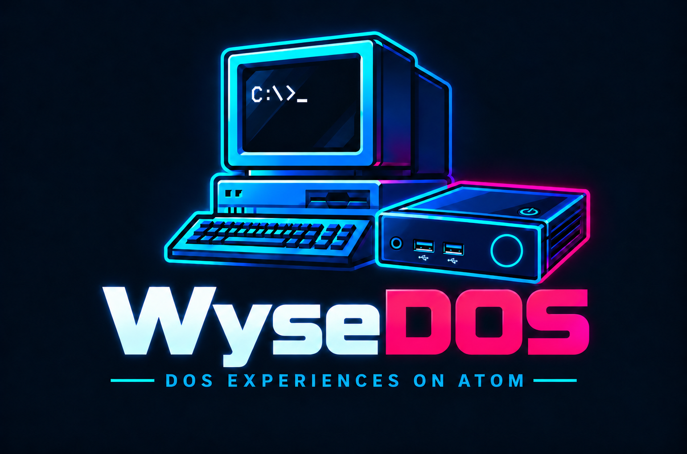

<p align="center">
  
</p>

<p align="center">
  <b>Almost bare-metal x86 on the Dell Wyse 3040 - a 386/486/Pentium PC monitor and emulator that runs directly on UEFI</b>
</p>

---

**wyseDOS** turns a Dell Wyse 3040 thin client into a dedicated DOS and Windows 9x
machine. There is no Linux kernel or host operating system underneath: UEFI
loads `BOOTX64.EFI`, which runs the guest PC using VT-x and emulated peripherals.
The monitor keeps UEFI Boot Services active for firmware-backed USB, storage,
networking and events, alongside direct Cherry Trail VGA and audio access.
See [architecture](docs/architecture.md) for the hardware/firmware boundary.

DOS Glide runs through an emulated **3dfx Voodoo2** with 8 or 12 MB of memory.
Windows 98 uses the bundled [Velocity9x driver](drivers/windows9x/velocity9x/README.md)
for the VGA/VBE desktop and **Direct3D, Glide and OpenGL** through the Intel
Gen8 GPU. The GPU menu provides separate CPU Boost switches for DOS Glide
and Windows 3D; no separate Windows booster program is required.

The emulator core and peripheral set come from
[X86Pi](https://github.com/AidenShaw2020/x86pi) (itself built on the PC
peripherals of [tiny386](https://github.com/hchunhui/tiny386)), adapted for
x86-64 bare metal on the Intel Atom x5-Z8350 with both hardware-assisted
virtualisation (Intel VT-x unrestricted guest) and cycle-paced software
emulation.

## Game showcase

DOS and Windows 98 games running on a **Dell Wyse 3040**. The original four
DOS clips use an eMMC boot and **16 MB guest RAM**; the four 3D clips use
**128 MB guest RAM**. All clips are **720p60**, played at original speed,
with captured digital audio. Tomb Raider's game sound is disabled.

| Game | Game resolution | Performance measurement |
|---|---|---|
| **Doom** | 320×200, high detail | **64.50 FPS** — separate unlocked `demo3` timedemo, sound off |
| **Quake** | 320×200 → 640×480 | **62.4 → 16.6 FPS** — separate `demo1` timedemos, sound off |
| **Duke Nukem 3D** | 320×200 | In-game **DNRATE** counter in the clip's final, separately marked scene |
| **Tyrian 2000** | 320×200 | **31.2 FPS** — separate early-level debug sample, normal speed / low detail |
| **Tomb Raider / DOS Glide** | 640x480 | **21.71 FPS** - 437 completed frames / 20.129 s at the stationary level start |
| **NFS III / Windows DirectX (DX5)** | 640x480 | **29.59 FPS** - 621 handled Flips / 20.984 s of driving; zero declined Flips |
| **NFS III / Windows Glide** | 640x480 | **16.47 swap calls/s** - 247 calls / 15.001 s race interval |
| **Quake II / Windows OpenGL** | 640x480 | **35.09 FPS** - separate opening-scene rotation benchmark |

Game FPS and capture FPS are different measurements. The original four DOS clips have sound
enabled; Doom and Quake benchmark results come from separate no-sound runs.
Duke3D's counter is scene-dependent, and Tyrian's sample is not an unlocked
benchmark or the recorded demo's average.

<details open>
<summary><strong>Doom</strong> · 18 seconds · high-detail demo with sound</summary>

https://github.com/user-attachments/assets/93d561f5-158c-41cc-b80b-a2e4b9697752

</details>

<details>
<summary><strong>Quake</strong> · 30 seconds · 320×200 and 640×480 side-by-side in time</summary>

The resolution changes after 15 seconds. Both segments use the software
renderer with sound effects enabled.

https://github.com/user-attachments/assets/adaf09d4-b03b-4b69-a57e-363d88114b64

</details>

<details>
<summary><strong>Duke Nukem 3D</strong> · 25 seconds · action demo and live FPS counter</summary>

An 18-second built-in demo is followed by a clearly marked 7-second rooftop
scene showing the game's own FPS counter. Its values apply to that scene.

https://github.com/user-attachments/assets/7ca1a682-eaba-4a30-b432-ed5d3b593327

</details>

<details>
<summary><strong>Tyrian 2000</strong> · 25 seconds · built-in demo with music and effects</summary>

https://github.com/user-attachments/assets/5645a36b-19c8-43b2-8efc-84873c90fd31

</details>

The 3D clips use 12 MB Voodoo2 memory, a 64 MB Windows GPU workspace and
a 133 MHz base CPU profile with automatic CPU Boost. NFS III retains medium
graphics, mirror, VSync and sound. The results apply to the measured scenes;
the NFS clips are not a controlled speed comparison between APIs. See the
[3D recording notes](docs/video/README.md) for counter definitions and capture
limits. The replacement Tomb Raider and DX5 clips use direct 60 fps capture.

<details>
<summary><strong>Tomb Raider</strong> · 30 seconds · DOS Glide and automatic CPU Boost</summary>

The measured section is the original stationary level start, followed by
unmeasured movement. After using Windows 3D, a repeat through a DOS boot
measured 21.68 FPS in the same scene.

https://github.com/user-attachments/assets/ccedbfa9-1434-4aef-a04d-e2ba064c99da

</details>

<details>
<summary><strong>Need for Speed III</strong> · 25 seconds · Windows DirectX / DX5</summary>

Hometown / Corvette, driving with the original DX5 renderer, VSync and sound.

https://github.com/user-attachments/assets/84a64f80-00bb-4efa-81c9-812f942ede15

</details>

<details>
<summary><strong>Need for Speed III</strong> · 22 seconds · Windows Glide</summary>

Velocity9x Glide3, Hometown / Corvette. The caption reports swap calls;
it does not independently measure display completion.

https://github.com/user-attachments/assets/a029aa05-ff47-4114-88f9-09dfd7e0ad3d

</details>

<details>
<summary><strong>Quake II</strong> · 25 seconds · Windows OpenGL</summary>

Velocity9x Intel Gen8 OpenGL. The 35.09 FPS result is the separate opening
rotation benchmark, not the moving footage's average.

https://github.com/user-attachments/assets/25071566-8de0-40da-a41e-ed08b81dc538

</details>

## Documentation

Start with the [documentation index](docs/index.md):

- [Installation and guest OS setup](docs/installation.md)
- [Configuration and controls](docs/configuration.md)
- [Windows 98 display and 3D driver](drivers/windows9x/velocity9x/INSTALL.TXT)
- [DOS Glide and Voodoo2](docs/voodoo2.md)
- [Storage, USB and image mounting](docs/storage.md)
- [Architecture and source map](docs/architecture.md)
- [Compatibility and known limits](docs/compatibility.md)
- [Troubleshooting](docs/troubleshooting.md)
- [Building and testing](docs/development.md)
- [Release history](CHANGELOG.md)

## What is inside

| Component | Emulated hardware |
|---|---|
| **Processor** | 386 / 486 / Pentium with optional x87 FPU; Intel VT-x execution with configurable instruction-rate limits or unrestricted speed. MHz profiles approximate each generation; they are not cycle-accurate CPU models. |
| **Memory** | Configurable conventional + extended RAM (installer default 128 MB, up to 256 MB), LIM EMS 4.0 at `0xD000` |
| **Video** | IBM VGA (text, CGA, EGA, Mode X, 256-colour) and VESA VBE 2.0 LFB modes up to 1280x1024 in 8/15/16/24/32 bpp with 8 MB VRAM |
| **3D graphics** | DOS Glide through Voodoo2 emulation (8/12 MB); Windows 98 Direct3D, Glide and OpenGL through Velocity9x and Intel Gen8. Windows GPU workspace: 32/64/128 MB, separate from VGA VRAM. |
| **Sound** | AdLib / Dual OPL2 / OPL3 ([Nuked OPL3](https://github.com/nukeykt/Nuked-OPL3)), Sound Blaster 16 (DSP 4.05, 8-bit and 16-bit DMA, mixer, auto-init), MPU-401 General MIDI ([TinySoundFont](https://github.com/schellingb/TinySoundFont)), Tandy 3-voice (SN76489), Covox Speech Thing & Disney Sound Source on LPT1, PC speaker (PIT channel 2) |
| **Disks** | Dual IDE/ATA channels (hard disks and ATAPI CD-ROMs, using the native eMMC guest disk, `.img`/`.iso` files or a physical USB CD-ROM drive as appropriate), two 3.5" floppy drives (`.img`/`.ima` or a physical USB floppy drive) |
| **Network** | NE2000 ISA / ISA PnP Ethernet adapter bridged to the USB/on-board Ethernet |
| **Input** | i8042 AT/PS/2 keyboard and 3-button PS/2 Intellimouse with scroll wheel, dual analogue gameport at `0x201` |
| **Clock** | MC146818 CMOS RTC fed from the hardware RTC |

Timing notes cover [display-derived audio clocks](docs/audio-clock.md) and
[Sound Blaster DMA synchronization](docs/sound-dma.md), including hardware
validation and regression tests.
The [native VGA page-flip notes](docs/vga-page-flips.md) explain frame lifetime,
fine panning and the regression test for incomplete moving sprites.

## How the Wyse 3040 is used

The Dell Wyse 3040 has a quad-core Intel Atom x5-Z8350 (Cherry Trail, 1.44 GHz /
1.92 GHz burst), 2 GB DDR3L RAM, 8 GB on-board eMMC, DisplayPort outputs, four
USB ports (one USB 3.0, three USB 2.0), Gigabit Ethernet, and an analog headphone codec
driven by the RT5672/I2S backend on the qualified unit.

| Part | Role |
|---|---|
| **Core 0** | Runs the guest CPU (Intel VT-x VMX non-root mode with EPT and I/O + MMIO trapping, or the software interpreter), hardware I/O emulation, storage and USB polling |
| **Core 1** | OPL synthesis, audio mixing and display-audio pumping |
| **Core 2** | VGA snapshots, rendering and copying to the display framebuffer |
| **Core 3** | General MIDI synthesis, analog headphone FIFO feeding and hang monitoring |
| **Display** | UEFI GOP framebuffer with monitor-side rendering/scaling; native legacy VGA for suitable guest modes |
| **Storage** | UEFI Block I/O with caching and a bounded native eMMC guest disk (`host:emmc`) |
| **USB** | Firmware USB I/O for physical HID/storage; virtual UHCI/BOT for guest USB disks |

## Installing on the Wyse 3040

1. Download **`wysedos-installer.img`** from
   [wyseDOS v1.1.15](https://github.com/AidenShaw2020/wysedos/releases/tag/v1.1.15) (or build it
   from source with `./tools/installer/build.sh`).
2. Write `wysedos-installer.img` to a USB flash drive in raw / DD mode (using
   Rufus in DD mode, balenaEtcher or `dd`).
3. Plug the USB stick into the Wyse 3040, power it on, press **F12** at the Dell
   splash screen and select the USB stick in the UEFI boot menu.
4. Select **U — Upgrade** to update an existing supported installation while
   keeping C: and settings (confirm with U again), or **I — New install** to
   erase and prepare eMMC (separate Y confirmation). Esc cancels.
   A new installation partitions the internal 8 GB eMMC as follows:
   - **System partition (`WYSEDOS`, 128 MB FAT32, hidden `0x1C` in MBR)** —
     stores `\EFI\BOOT\BOOTX64.EFI` and `\386\` (`bios.bin`, `vgabios.bin`,
     `config.ini`, `gm.sf2`, `logo.bin`), and registers the `wyseDOS` UEFI boot
     entry in NVRAM.
   - **Guest disk (`C:`, ~7.1 GB FAT32 LBA `0x0C` in MBR)** — exposed directly
     to the guest PC as the primary master IDE hard disk (`hda=host:emmc`), with
     the system partition hidden outside the guest disk bounds so DOS `FDISK`,
     `FORMAT` and Windows 98 Setup see a clean single-disk PC.
5. Remove the USB stick when installation or upgrade completes and press
   any key to reboot into **wyseDOS**.

See [installation and upgrade details](docs/installation.md) for detection,
retained settings and interrupted-update recovery. Upgrade does not replace
guest drivers or operating system files.

## Installing DOS or Windows 9x

Because the guest `C:` drive lives on the internal eMMC (`hda=host:emmc`), you
can install an operating system onto it just as on a real PC:

- **Physical USB floppy and USB CD-ROM (tested)**: connect a USB floppy or
  USB CD-ROM drive with real installation media. The physical CD drive is
  presented as an ATAPI CD-ROM; no ISO conversion or guest USB flash driver
  is required. In DOS, load the usual ATAPI CD driver and MSCDEX.
- **Image files on USB storage**: connect a FAT32 USB stick holding `.img` /
  `.iso` installation media. See [physical drives and image sources](docs/storage.md).
- **Disk Manager (`Win + F12`)**: open the on-screen disk manager at any time to
  mount floppy images (`.img` / `.ima`) in `A:` / `B:`, CD-ROM images (`.iso`)
  on the secondary IDE channel, or pick a boot device and restart.
- **USB flash drives and external hard disks**: with
  `usb_storage=1` (the default), unassigned USB disks attach automatically to
  the guest's virtual PIIX3 UHCI controller. Disk Manager shows their ownership
  and lets you browse image files in arbitrary directories on FAT12/16/32
  external media. Before taking a disk in Windows, close its files and use
  the system's Stop/Eject dialog. Confirm the takeover in Disk Manager:
  the entire source disk disappears from guest USB while any of its images
  are mounted. After the last image is ejected, it is flushed and returned
  automatically to USB. Image paths on external media are temporary and must
  be selected again after a monitor restart. Guest C:/eMMC is not browsable.
  A compatible, separately licensed guest USB mass-storage driver is still
  required in Windows. The installer supplies the real-DOS USB drivers in
  `C:\DRIVERS`; it does not supply Windows USB storage packages.
  Physical floppy and CD-ROM handling is unchanged.
- **Windows 98 display and 3D driver**: the modified
  [Velocity9x package](drivers/windows9x/velocity9x/README.md) provides the
  VGA/VBE desktop and Direct3D, Glide and OpenGL through WGPU/Gen8.

## Hotkeys

The **Left Windows** key is the emulator's host key and is not passed through to
DOS:

| Key | Action |
|---|---|
| `Win + F12` | Open the **Disk Manager** (mount/eject floppy, HDD and CD-ROM images, attach physical USB floppy/CD-ROM, select one-shot boot drive) |
| `Win + F11` | Open the **Settings** menu (CPU speed, RAM, audio cards, per-channel volumes, mouse speed, power behaviour) |
| `Win + Delete` | Reset the guest PC (unsaved guest work is lost) |
| `Win + R` | Reboot the physical Wyse (shut down Windows first) |

## Configuration (`386/config.ini`)

Both the Settings menu (`Win+F11`) and the Disk Manager (`Win+F12`) save their
changes back to `\386\config.ini` on the `WYSEDOS` system partition:

```ini
[pc]
mem=128M
vga_mem=8192K
cpu=5
fpu=1
voodoo2=1
voodoo2_mem=12
wgpu=64
wgpu_enabled=1
bios=bios.bin
vga_bios=vgabios.bin
hda=host:emmc
timezone=cet
firmware_timer_us=5000

[wyseDOS]
speed=133
voodoo2_turbo=1
graphics_turbo=1
volume=12
vol_pcspeaker=16
vol_adlib=16
vol_soundblaster=16
vol_midi=16
vol_tandy=16
vol_covox=16
vol_headphones=16
pcspeaker=1
adlib=1
soundblaster=1
mpu401=1
tandy=0
covox=0
dss=0
mouse=1
mouse_invert_y=0
mouse_speed=100
joystick=0
power_restore=1
power_button=0
```

In **GPU** settings, `CPU Boost DOS: Glide` enables unrestricted CPU speed
while DOS Glide owns the display. `CPU Boost Windows: DirectX/Glide/OpenGL`
activates on accepted 3D driver submissions and returns to the selected base
speed when activity ends. Both are independent of the hardware enable and
memory settings. Windows GPU memory is host workspace, not additional VGA
VRAM. See [GPU settings](docs/configuration.md) for all options.

`firmware_timer_us` defaults to 5000 (5 ms). It shortens a slower firmware
hardware timer so USB mouse completions are delivered more regularly; an
already faster timer is preserved. Set it to `0` to retain the firmware's
original timing. See [input timing and diagnostics](docs/input-timing.md).

## Building from source

Building requires **Clang** and **lld-link** with the `x86_64-unknown-windows`
target (Windows LLVM installation with Git Bash) and **Python 3**.

### Build the UEFI monitor (`bootx64.efi`)

```sh
./efi/build.sh
```

This compiles the UEFI entry point, Cherry Trail platform drivers, FatFs, TinySoundFont,
Nuked OPL3 and the PC emulator into `efi/build/bootx64.efi`.

### Build the bootable USB installer (`wysedos-installer.img`)

```sh
./tools/installer/build.sh
```

This builds `efi/build/bootx64.efi` and packs it together with `disks/386/` into
a bootable FAT32 USB image at `tools/installer/out/wysedos-installer.img`.

The installer builder also requires Python 3. It checks pinned upstream
archive hashes and adds an unpacked `DRIVERS/` payload. After creating the
guest FAT32 partition, the installer copies the modified Velocity9x 3D driver,
Bret Johnson's DOS USB drivers and CuteMouse 2.1b4 (including
sources) to `C:\DRIVERS`. These drivers
retain their own licences; see the bundled instructions.

NUSB FE, NUSB SE and the SanDisk-based Win95 package are excluded because
redistribution permissions for their proprietary components have not been
established. This repository supplies no download links or downloader for
them. Windows USB storage requires a separately supplied compatible driver.

## Repository layout

| Directory | Contents |
|---|---|
| `efi/` | UEFI bootstrap, page tables, SMP core bring-up, Intel VT-x hypervisor (`cpuvmx.c`), GOP display (`wyse.c`), LPE/RT5672 audio (`audio.c`, `lpe.c`, `analog.c`), firmware-backed storage (`bio.c`, `hostblk.c`), USB HID (`usbhid.c`), installer (`installer.c`) |
| `pc/` | Shared PC emulator and peripherals: i386/486/Pentium core and FPU, VGA/VBE, IDE/ATAPI, floppy, i8254 PIT, i8259 PIC, i8257 DMA, i8042 PS/2 keyboard & mouse, SB16, AdLib/Nuked OPL3, MPU-401/TinySoundFont, SN76489, Covox/DSS, NE2000, PCI, ACPI, OSD menus |
| `disks/386/` | Runtime assets installed to `\386\`: SeaBIOS (`bios.bin`), SeaVGABios (`vgabios.bin`), General MIDI soundfont (`gm.sf2`), boot logo (`logo.bin`), guest MBR template (`guest_mbr.bin`) and default `config.ini` |
| `drivers/windows9x/` | Modified Velocity9x Windows 98 WGPU/Gen8 3D package, with licenses and corresponding source |
| `tools/` | USB installer builder (`tools/installer/`), ACPI table compiler (`tools/acpi/`), VGA BIOS EDID patcher (`tools/vgabios/`), boot logo converter (`tools/logo/`) and unit tests (`tools/tests/`) |

## Acknowledgements and licence

- **[tiny386](https://github.com/hchunhui/tiny386)** by `./main.c` (`hchunhui`) —
  the 386/486 core and PC peripheral models on which [X86Pi](https://github.com/AidenShaw2020/x86pi) and **wyseDOS** are built.
- **[Nuked OPL3](https://github.com/nukeykt/Nuked-OPL3)** by Alexey Khokholov (`Nuke.YKT`) — cycle-accurate Yamaha YMF262 (OPL3) emulator.
- **[TinySoundFont](https://github.com/schellingb/TinySoundFont)** by Bernhard Schelling — SoundFont2 synthesiser.
- **[FatFs](http://elm-chan.org/fsw/ff/)** by ChaN — FAT/exFAT filesystem module.
- **[SeaBIOS / SeaVGABIOS](https://www.seabios.org/)** by Kevin O'Connor,
  Julian Pidancet, the LGPL VGABios developers Team and other contributors —
  the x86 BIOS and VGA BIOS. Complete **LGPLv3 and GPLv3** licence texts and
  notices accompany the ROMs in the installer. See the [licence texts,
  ROM hashes and corresponding-source status](LICENSES/seabios.md).
- **GeneralUser GS** (`disks/386/gm.sf2`) by S. Christian Collins — see [`disks/386/gm.sf2.LICENSE.txt`](disks/386/gm.sf2.LICENSE.txt).
- **[Velocity9x](https://github.com/michaeldale/velocity9x)** — the modified
  Windows 98 DirectDraw/Direct3D, Glide and OpenGL driver, under **GPLv3**.
  The [fork package](drivers/windows9x/velocity9x/README.md) includes complete
  corresponding modified source and preserves upstream third-party notices.
  See the [license](LICENSES/velocity9x.txt).
- **[86Box](https://github.com/86Box/86Box)** — the pinned Voodoo renderer and
  span recompiler, used under GPLv3 from its GPL-2.0-or-later distribution.
  See [provenance and port changes](pc/voodoo/UPSTREAM.md) and its preserved
  [license](pc/voodoo/86box/COPYING).
- **[CuteMouse](https://cutemouse.sourceforge.net/)** by Nagy Daniel, with
  maintenance and contributions by Eric Auer and other contributors — DOS
  mouse driver under **GPL-2.0-or-later**. The [upstream archive](drivers/dos/ctmouse.zip)
  includes sources and `COPYING`; the installer also unpacks those sources.
  Included ASMLIB sources by Arkady Belousov retain their **LGPL-2.1-or-later** notices.
- **[DOS USB drivers](https://bretjohnson.us/)** by Bret E. Johnson, with
  Richard Bonner credited for contributions — copyrighted **freeware under
  its own terms**, not the project GPL. The complete redistribution conditions
  are in `USBINTRO.DOC` inside the preserved [upstream package](drivers/dos/usbdos/README.md).
- **Excluded packages:** NUSB by Maximus Decim (FE adaptation credited to
  Q@PassingBy), and Nathan Lineback's SanDisk-based Win95 USB package. Their
  names are recorded for historical acknowledgement only. Their proprietary
  files and download links are not distributed with this project.

The wyseDOS code is released under the **GNU General Public License v3.0** —
see [`LICENSE`](LICENSE) and [`LICENSES/`](LICENSES/). Bundled third-party guest
drivers retain their own terms. Excluded Windows USB packages are not part
of the GPL distribution; their redistribution permissions remain unverified.
