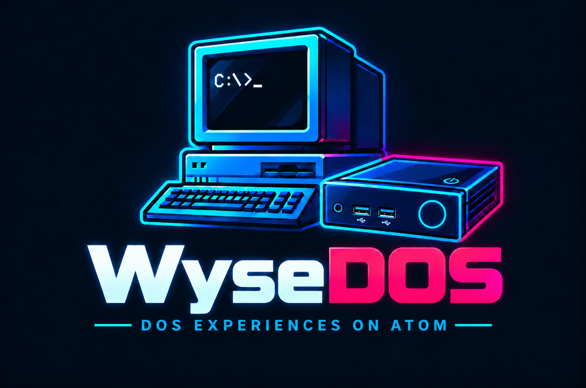

<p align="center">
  
</p>

<p align="center">
  <b>DOS, Windows 9x, Windows 2000 and Windows XP on the Dell Wyse 3040</b>
</p>

---

**wyseDOS** runs DOS/Windows 9x or Windows NT directly on the Dell Wyse 3040.
UEFI loads `BOOTX64.EFI`, which runs a virtual x86 PC using Intel VT-x and
emulated peripherals. The monitor runs without a host operating system.
The monitor keeps UEFI Boot Services active for firmware-backed USB, storage,
networking and events, alongside direct Cherry Trail VGA and audio access.
See [architecture](docs/architecture.md) for the hardware/firmware boundary.

| Guest installation | Graphics acceleration | Driver setup |
|---|---|---|
| **DOS and Windows 9x** | DOS Glide through emulated Voodoo2. Windows 98 Direct3D, Glide and OpenGL through Intel Gen8. | [DOS and Windows 9x setup](#dos-and-windows-9x) · [Velocity9x](drivers/windows9x/velocity9x/README.md) |
| **Windows 2000 and Windows XP** | GPU-accelerated desktop and DirectDraw, legacy Direct3D and OpenGL 1.1 through Intel Gen8. | [Windows 2000 and XP setup](#windows-2000-and-windows-xp) · [NT5 graphics](docs/nt5-support.md) |

Both installation choices use the same firmware, internal guest disk and
shared driver CD. Choose an OS family at install time. Windows 2000 SP4
and XP SP3 boot directly from their own system partition. DOS and Windows
9x can share the same DOS-based installation.

The GPU menu provides automatic CPU Boost for DOS Glide and Windows 3D.
The Windows switch applies to accelerated work in Windows 98, 2000 and XP.

The emulator core and peripheral set come from
[X86Pi](https://github.com/AidenShaw2020/x86pi) (itself built on the PC
peripherals of [tiny386](https://github.com/hchunhui/tiny386)), adapted for
x86-64 bare metal on the Intel Atom x5-Z8350 with both hardware-assisted
virtualisation (Intel VT-x unrestricted guest) and cycle-paced software
emulation.

## Installing on the Wyse 3040

1. Download **`wysedos-installer.img`** from
   [wyseDOS releases](https://github.com/AidenShaw2020/wysedos/releases) or
   [build it from source](docs/development.md).
2. Write `wysedos-installer.img` to a USB flash drive in raw / DD mode (using
   Rufus in DD mode, balenaEtcher or `dd`).
3. Plug the USB stick into the Wyse 3040, power it on, press **F12** at the Dell
   splash screen and select the USB stick in the UEFI boot menu.
4. Select **U — Upgrade** to update an existing supported installation while
   keeping C: and settings (confirm with U again), or **I — New install** to
   erase and prepare eMMC (separate Y confirmation). Esc cancels.
   A new installation partitions the internal 8 GB eMMC as follows:
   - **Firmware partition (`WYSEDOS`, 128 MiB FAT32 on GPT)** —
     stores `\EFI\BOOT\BOOTX64.EFI` and `\386\` (`bios.bin`, `vgabios.bin`,
     `config.ini`, `gm.sf2`, `logo.bin`, `drivers.iso`), and registers the `wyseDOS` UEFI boot
     entry in NVRAM.
   - **Guest disk** — exposes the remaining eMMC capacity as the primary
     master IDE disk (`hda=host:emmc`). DOS or Windows Setup creates the
     partition and filesystem inside that disk.
5. Remove the USB stick when installation or upgrade completes and press
   any key to reboot into **wyseDOS**.

See [installation and upgrade details](docs/installation.md) for detection,
retained settings and interrupted-update recovery. Upgrade does not replace
guest drivers or operating system files.

### DOS and Windows 9x

1. Boot DOS from your own floppy, CD or image using Win+F12.
2. Use DOS partitioning and formatting tools on the internal guest disk
   and install DOS. Run Windows Setup from your own Windows 9x media
   if you want a Windows desktop.
3. Open Win+F12 and mount the firmware's `drivers.iso`. For Windows 98,
   install the driver from `VELOCITY`. The `USBDOS` and `CTMOUSE`
   directories contain the DOS USB and mouse drivers.
   [DOS and Windows 9x setup](docs/installation.md#install-dos-and-windows-9x)

### Windows 2000 and Windows XP

1. For NT, select full CPU speed in Settings with Win+F11. Boot your own
   32-bit Windows 2000 or XP CD or ISO using Win+F12.
2. Let Windows Setup partition and format the guest disk. Continue from
   the hard disk when Setup restarts.
3. At the desktop, mount the firmware's `drivers.iso` with Win+F12.
   From its `NT5` directory run `NTINST.EXE --install` and then
   `NTINST.EXE --display` as Administrator. Restart when prompted.
4. Use the installed XDDM driver for DirectDraw and legacy Direct3D, and the
   bundled system ICD for OpenGL. [NT5 configuration and compatibility](docs/nt5-support.md)

### Installation media and USB

Disk Manager can mount bootable images from external FAT storage and
attach physical USB floppy and CD-ROM drives. In DOS, load the usual
ATAPI CD driver and MSCDEX. In Windows, stop an external disk before
handing it to Disk Manager. It returns to guest USB after the last image
on it is ejected. Windows USB mass storage requires a compatible driver
for the installed Windows version. [Media mounting and ownership](docs/storage.md)

## Game showcase

Games running on a **Dell Wyse 3040** under DOS, Windows 98, Windows 2000
and Windows XP. All files are **720p60** and play at their original speed.
The NT clips use direct HDMI capture with digital audio.

| Game | Game resolution | Performance measurement |
|---|---|---|
| **Doom** | 320×200, high detail | **64.50 FPS** — separate unlocked `demo3` timedemo, sound off |
| **Quake** | 320×200 → 640×480 | **62.4 → 16.6 FPS** — separate `demo1` timedemos, sound off |
| **Duke Nukem 3D** | 320×200 | In-game **DNRATE** counter in the clip's final, separately marked scene |
| **Tyrian 2000** | 320×200 | **31.2 FPS** — separate early-level debug sample, normal speed / low detail |
| **Tomb Raider / DOS Glide** | 640x480 | **21.71 FPS** - 437 completed frames / 20.129 s at the stationary level start |
| **NFS III / Windows 98, Direct3D 5** | 640x480 | **29.59 FPS** over 20.984 s of driving |
| **NFS III / Windows 2000, Direct3D 5** | 640x480 | **27.65 FPS** over 30.02 s of driving |
| **NFS III / Windows XP, Direct3D 5** | 640x480 | **27.94 FPS** over 30.03 s of driving |
| **NFS III / Windows 98, Glide** | 640x480 | **16.47 swap calls/s** over 15.001 s of driving |
| **Quake II / Windows 98, 2000 and XP, OpenGL** | 640x480 | **35.09 / 29.44 / 29.53 FPS**, separate opening-scene rotation |

Game FPS and capture FPS are different measurements. The original four DOS clips have sound
enabled; Doom and Quake benchmark results come from separate no-sound runs.
Duke3D's counter is scene-dependent, and Tyrian's sample is not an unlocked
benchmark or the recorded demo's average.

<details open>
<summary><strong>Doom</strong> · 18 seconds · high-detail demo with sound</summary>

https://github.com/user-attachments/assets/93d561f5-158c-41cc-b80b-a2e4b9697752

</details>

<details>
<summary><strong>Quake</strong> · 30 seconds · 320×200 and 640×480 side-by-side in time</summary>

The resolution changes after 15 seconds. Both segments use the software
renderer with sound effects enabled.

https://github.com/user-attachments/assets/adaf09d4-b03b-4b69-a57e-363d88114b64

</details>

<details>
<summary><strong>Duke Nukem 3D</strong> · 25 seconds · action demo and live FPS counter</summary>

An 18-second built-in demo is followed by a clearly marked 7-second rooftop
scene showing the game's own FPS counter. Its values apply to that scene.

https://github.com/user-attachments/assets/7ca1a682-eaba-4a30-b432-ed5d3b593327

</details>

<details>
<summary><strong>Tyrian 2000</strong> · 25 seconds · built-in demo with music and effects</summary>

https://github.com/user-attachments/assets/5645a36b-19c8-43b2-8efc-84873c90fd31

</details>

The DOS and Windows 98 3D clips use a 133 MHz base CPU profile with
automatic CPU Boost and a 64 MB Windows GPU workspace. The Windows 2000
and XP benchmarks use an unrestricted CPU. The figures apply to the
scenes measured. [Recording conditions](docs/video/README.md)

<details>
<summary><strong>Tomb Raider</strong> · 30 seconds · DOS Glide and automatic CPU Boost</summary>

The measured section is the original stationary level start, followed by
unmeasured movement. After using Windows 3D, a repeat through a DOS boot
measured 21.68 FPS in the same scene.

https://github.com/user-attachments/assets/ccedbfa9-1434-4aef-a04d-e2ba064c99da

</details>

<details>
<summary><strong>Need for Speed III</strong> · 25 seconds · Windows DirectX / DX5</summary>

Hometown / Corvette, driving with the original DX5 renderer, VSync and sound.

https://github.com/user-attachments/assets/5b0644e6-2e52-42bc-a817-b1f0330182d2

</details>

<details>
<summary><strong>Need for Speed III</strong> · 22 seconds · Windows Glide</summary>

Velocity9x Glide3, Hometown / Corvette. The caption reports swap calls;
it does not independently measure display completion.

https://github.com/user-attachments/assets/d2db54b6-d459-40ef-a5dd-0abe269c8034

</details>

<details>
<summary><strong>Quake II</strong> · 25 seconds · Windows OpenGL</summary>

Velocity9x Intel Gen8 OpenGL. The 35.09 FPS result is the separate opening
rotation benchmark, not the moving footage's average.

https://github.com/user-attachments/assets/25071566-8de0-40da-a41e-ed08b81dc538

</details>

<details>
<summary><strong>Need for Speed III</strong> · Windows 2000 and XP · Direct3D 5</summary>

**Windows 2000**

https://github.com/user-attachments/assets/19a39fce-11e7-4bfe-b5e9-51b5589da4b5

**Windows XP**

https://github.com/user-attachments/assets/5fc4b346-770e-4f02-9349-f1c86f9c88bd

</details>

<details>
<summary><strong>Quake II</strong> · Windows 2000 and XP · OpenGL</summary>

The footage shows selected passages from Comm Center with
the game's lightmap intensity increased for visibility. Its footers report
the separate 640x480 opening-scene benchmark with default intensity.
[Recording conditions](docs/video/README.md)

**Windows 2000**

https://github.com/user-attachments/assets/91c403b7-9baf-426a-bde5-9562891d5ccc

**Windows XP**

https://github.com/user-attachments/assets/06a94201-6ad6-4418-8548-4897e0b06978

</details>

## Documentation

Start with the [documentation index](docs/index.md):

- [Installation and guest OS setup](docs/installation.md)
- [Configuration and controls](docs/configuration.md)
- [Windows 98 display and 3D driver](drivers/windows9x/velocity9x/INSTALL.TXT)
- [Windows 2000 and XP graphics preview](docs/nt5-support.md)
- [DOS Glide and Voodoo2](docs/voodoo2.md)
- [Storage, USB and image mounting](docs/storage.md)
- [Architecture and source map](docs/architecture.md)
- [Compatibility and known limits](docs/compatibility.md)
- [Troubleshooting](docs/troubleshooting.md)
- [Building and testing](docs/development.md)
- [Release history](CHANGELOG.md)

## What is inside

| Component | Emulated hardware |
|---|---|
| **Processor** | 386, 486, Pentium, Pentium II and Pentium III profiles. The P6 profiles identify as distinct processors and expose the features supported by the backend. Intel VT-x execution with approximate rate limits or unrestricted speed. |
| **Memory** | Configurable conventional + extended RAM (installer default 128 MB, up to 256 MB), LIM EMS 4.0 at `0xD000` |
| **Video** | IBM VGA (text, CGA, EGA, Mode X, 256-colour) and VESA VBE 2.0 LFB modes up to 1280x1024 in 8/15/16/24/32 bpp with 8 MB VRAM |
| **3D graphics** | DOS Glide through Voodoo2 emulation (8/12 MB). Intel Gen8 acceleration for Direct3D, Glide and OpenGL in Windows 98, and for Direct3D and OpenGL in Windows 2000/XP. Windows GPU workspace sizes 32/64/128 MB. |
| **Sound** | AdLib / Dual OPL2 / OPL3 ([Nuked OPL3](https://github.com/nukeykt/Nuked-OPL3)), Sound Blaster 16 (DSP 4.05, 8-bit and 16-bit DMA, mixer, auto-init), MPU-401 General MIDI ([TinySoundFont](https://github.com/schellingb/TinySoundFont)), Tandy 3-voice (SN76489), Covox Speech Thing & Disney Sound Source on LPT1, PC speaker (PIT channel 2) |
| **Disks** | Dual IDE/ATA channels (hard disks and ATAPI CD-ROMs, using the native eMMC guest disk, `.img`/`.iso` files or a physical USB CD-ROM drive as appropriate), two 3.5" floppy drives (`.img`/`.ima` or a physical USB floppy drive) |
| **Network** | NE2000 ISA / ISA PnP Ethernet adapter bridged to the USB/on-board Ethernet |
| **Input** | i8042 AT/PS/2 keyboard and 3-button PS/2 Intellimouse with scroll wheel, dual analogue gameport at `0x201` |
| **Clock** | MC146818 CMOS RTC fed from the hardware RTC |

Timing notes cover [display-derived audio clocks](docs/audio-clock.md) and
[Sound Blaster DMA synchronization](docs/sound-dma.md), including hardware
validation and regression tests.
The [native VGA page-flip notes](docs/vga-page-flips.md) explain frame lifetime,
fine panning and the regression test for incomplete moving sprites.

## How the Wyse 3040 is used

The Dell Wyse 3040 has a quad-core Intel Atom x5-Z8350 (Cherry Trail, 1.44 GHz /
1.92 GHz burst), 2 GB DDR3L RAM, 8 GB on-board eMMC, DisplayPort outputs, four
USB ports (one USB 3.0, three USB 2.0), Gigabit Ethernet, and an analog headphone codec
driven by the RT5672/I2S backend on the qualified unit.

| Part | Role |
|---|---|
| **Core 0** | Runs the guest CPU (Intel VT-x VMX non-root mode with EPT and I/O + MMIO trapping, or the software interpreter), hardware I/O emulation, storage and USB polling |
| **Core 1** | OPL synthesis, audio mixing and display-audio pumping |
| **Core 2** | VGA snapshots, rendering and copying to the display framebuffer |
| **Core 3** | General MIDI synthesis, analog headphone FIFO feeding and hang monitoring |
| **Display** | UEFI GOP framebuffer with monitor-side rendering/scaling; native legacy VGA for suitable guest modes |
| **Storage** | UEFI Block I/O with caching and a bounded native eMMC guest disk (`host:emmc`) |
| **USB** | Firmware USB I/O for physical HID/storage; virtual UHCI/BOT for guest USB disks |

## Hotkeys

The **Left Windows** key is the emulator's host key and is not passed through to
DOS:

| Key | Action |
|---|---|
| `Win + F12` | Open the **Disk Manager** (mount/eject floppy, HDD and CD-ROM images, attach physical USB floppy/CD-ROM, select one-shot boot drive) |
| `Win + F11` | Open the **Settings** menu (CPU speed, RAM, audio cards, per-channel volumes, mouse speed, power behaviour) |
| `Win + Delete` | Reset the guest PC (unsaved guest work is lost) |
| `Win + R` | Reboot the physical Wyse (shut down Windows first) |

## Configuration (`386/config.ini`)

Both the Settings menu (`Win+F11`) and the Disk Manager (`Win+F12`) save their
changes back to `\386\config.ini` on the `WYSEDOS` system partition:

```ini
[pc]
mem=128M
vga_mem=8192K
cpu=5
fpu=1
voodoo2=1
voodoo2_mem=12
wgpu=64
wgpu_enabled=1
bios=bios.bin
vga_bios=vgabios.bin
hda=host:emmc
timezone=cet
firmware_timer_us=5000

[wyseDOS]
speed=133
voodoo2_turbo=1
graphics_turbo=1
volume=12
vol_pcspeaker=16
vol_adlib=16
vol_soundblaster=16
vol_midi=16
vol_tandy=16
vol_covox=16
vol_headphones=16
pcspeaker=1
adlib=1
soundblaster=1
mpu401=1
tandy=0
covox=0
dss=0
mouse=1
mouse_invert_y=0
mouse_speed=100
joystick=0
power_restore=1
power_button=0
```

In **GPU** settings, `CPU Boost DOS: Glide` enables unrestricted CPU speed
while DOS Glide owns the display. `CPU Boost Windows: DirectX/Glide/OpenGL`
activates on accepted 3D driver submissions and returns to the selected base
speed when activity ends. Both are independent of the hardware enable and
memory settings. Windows GPU memory is host workspace, not additional VGA
VRAM. See [GPU settings](docs/configuration.md) for all options.

`firmware_timer_us` defaults to 5000 (5 ms). It shortens a slower firmware
hardware timer so USB mouse completions are delivered more regularly; an
already faster timer is preserved. Set it to `0` to retain the firmware's
original timing. See [input timing and diagnostics](docs/input-timing.md).

## Building from source

Building requires **Clang** and **lld-link** with the `x86_64-unknown-windows`
target (Windows LLVM installation with Git Bash) and **Python 3**.

### Build the UEFI monitor (`bootx64.efi`)

```sh
./efi/build.sh
```

This compiles the UEFI entry point, Cherry Trail platform drivers, FatFs, TinySoundFont,
Nuked OPL3 and the PC emulator into `efi/build/bootx64.efi`.

### Build the bootable USB installer (`wysedos-installer.img`)

```sh
./tools/installer/build.sh out/wysedos-installer.img /absolute/path/to/wysedos-nt5-driver-package.iso
```

This builds `efi/build/bootx64.efi` and packs it together with `disks/386/` into
a bootable FAT32 USB image at `tools/installer/out/wysedos-installer.img`.

Install `pycdlib` for the CD builder and use the NT5 package ISO from the
release assets. The installer checks the pinned driver archives and packages
the DOS, Windows 9x and NT5 drivers together in `386/drivers.iso`. Windows
and DOS installation media are supplied separately.

NUSB FE, NUSB SE and the SanDisk-based Win95 package are excluded because
redistribution permissions for their proprietary components have not been
established. This repository supplies no download links or downloader for
them. Windows USB storage requires a separately supplied compatible driver.

## Repository layout

| Directory | Contents |
|---|---|
| `efi/` | UEFI bootstrap, page tables, SMP core bring-up, Intel VT-x hypervisor (`cpuvmx.c`), GOP display (`wyse.c`), LPE/RT5672 audio (`audio.c`, `lpe.c`, `analog.c`), firmware-backed storage (`bio.c`, `hostblk.c`), USB HID (`usbhid.c`), installer (`installer.c`) |
| `pc/` | Shared PC emulator and peripherals: i386/486/Pentium core and FPU, VGA/VBE, IDE/ATAPI, floppy, i8254 PIT, i8259 PIC, i8257 DMA, i8042 PS/2 keyboard & mouse, SB16, AdLib/Nuked OPL3, MPU-401/TinySoundFont, SN76489, Covox/DSS, NE2000, PCI, ACPI, OSD menus |
| `disks/386/` | SeaBIOS, SeaVGABIOS, General MIDI soundfont, boot logo and runtime assets |
| `drivers/windows9x/` | Modified Velocity9x Windows 98 WGPU/Gen8 3D package, with licenses and corresponding source |
| `drivers/nt/` | Windows 2000/XP WDM transport, WINVBE-derived XDDM driver, and OpenGL adapter |
| `tools/` | USB installer builder (`tools/installer/`), ACPI table compiler (`tools/acpi/`), VGA BIOS EDID patcher (`tools/vgabios/`), boot logo converter (`tools/logo/`) and unit tests (`tools/tests/`) |

## Acknowledgements and licence

- **[tiny386](https://github.com/hchunhui/tiny386)** by `./main.c` (`hchunhui`) —
  the 386/486 core and PC peripheral models on which [X86Pi](https://github.com/AidenShaw2020/x86pi) and **wyseDOS** are built.
- **[Nuked OPL3](https://github.com/nukeykt/Nuked-OPL3)** by Alexey Khokholov (`Nuke.YKT`) — cycle-accurate Yamaha YMF262 (OPL3) emulator.
- **[TinySoundFont](https://github.com/schellingb/TinySoundFont)** by Bernhard Schelling — SoundFont2 synthesiser.
- **[FatFs](http://elm-chan.org/fsw/ff/)** by ChaN — FAT/exFAT filesystem module.
- **[SeaBIOS / SeaVGABIOS](https://www.seabios.org/)** by Kevin O'Connor,
  Julian Pidancet, the LGPL VGABios developers Team and other contributors —
  the x86 BIOS and VGA BIOS. Complete **LGPLv3 and GPLv3** licence texts and
  notices accompany the ROMs in the installer. See the [licence texts,
  ROM hashes and corresponding-source status](LICENSES/seabios.md).
- **GeneralUser GS** (`disks/386/gm.sf2`) by S. Christian Collins — see [`disks/386/gm.sf2.LICENSE.txt`](disks/386/gm.sf2.LICENSE.txt).
- **[Velocity9x](https://github.com/michaeldale/velocity9x)** — the modified
  Windows 98 DirectDraw/Direct3D, Glide and OpenGL driver, under **GPLv3**.
  The [fork package](drivers/windows9x/velocity9x/README.md) includes complete
  corresponding modified source and preserves upstream third-party notices.
  See the [license](LICENSES/velocity9x.txt).
- **WINVBE** — upstream GPLv3 miniport and display-driver code used by the
  Windows 2000/XP preview. The driver bundle includes corresponding
  sources and licence notices. [NT graphics notices](LICENSES/winvbe.md)
- **[86Box](https://github.com/86Box/86Box)** — the pinned Voodoo renderer and
  span recompiler, used under GPLv3 from its GPL-2.0-or-later distribution.
  See [provenance and port changes](pc/voodoo/UPSTREAM.md) and its preserved
  [license](pc/voodoo/86box/COPYING).
- **[CuteMouse](https://cutemouse.sourceforge.net/)** by Nagy Daniel, with
  maintenance and contributions by Eric Auer and other contributors — DOS
  mouse driver under **GPL-2.0-or-later**. The [upstream archive](drivers/dos/ctmouse.zip)
  includes sources and `COPYING`; the installer also unpacks those sources.
  Included ASMLIB sources by Arkady Belousov retain their **LGPL-2.1-or-later** notices.
- **[DOS USB drivers](https://bretjohnson.us/)** by Bret E. Johnson, with
  Richard Bonner credited for contributions — copyrighted **freeware under
  its own terms**, not the project GPL. The complete redistribution conditions
  are in `USBINTRO.DOC` inside the preserved [upstream package](drivers/dos/usbdos/README.md).
- **Excluded packages:** NUSB by Maximus Decim (FE adaptation credited to
  Q@PassingBy), and Nathan Lineback's SanDisk-based Win95 USB package. Their
  names are recorded for historical acknowledgement only. Their proprietary
  files and download links are not distributed with this project.

The wyseDOS code is released under the **GNU General Public License v3.0** —
see [`LICENSE`](LICENSE) and [`LICENSES/`](LICENSES/). Bundled third-party guest
drivers retain their own terms. Excluded Windows USB packages are not part
of the GPL distribution; their redistribution permissions remain unverified.
