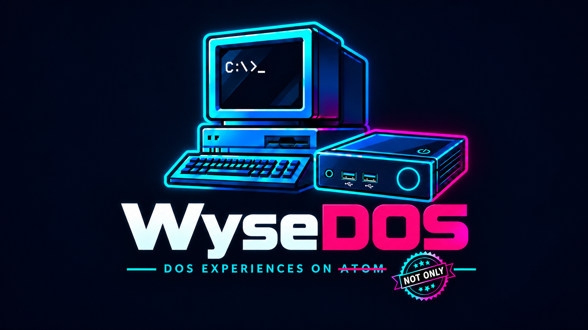

# Porting to other hardware

The Dell Wyse 3040 remains the supported target. We ended the HP port after
finding that graphics, audio and firmware timing required detailed tuning for
each host. The steps below describe where to start if you want to port
wyseDOS to another machine.

## Choose a test machine

- Use a PC that boots x86-64 UEFI applications and exposes Graphics Output
  Protocol (GOP). The boot policy must permit the test EFI binary. Keep UEFI
  Boot Services available for USB, storage, networking and timer services.
- For the existing CPU backend, check that firmware enables Intel VT-x and the
  CPU exposes Extended Page Tables (EPT) and unrestricted guest execution.
  Another virtualization architecture would need its own CPU backend.
- Start with four logical CPUs exposed through UEFI MP Services so the
  guest, audio, display and rendering workers can run separately. Use at least
  2 GiB of host RAM as a starting point based on the Wyse configuration.
  The host also needs space for the guest RAM, video buffers and firmware.
  [Current CPU and worker layout](architecture.md#cpu-cores)
- Use a disposable guest image on USB or UEFI IPv4 PXE, with GOP display and
  a USB keyboard for bring-up. Check firmware Block I/O and USB input on the
  actual machine. For network boot, verify the firmware network interface and
  test disk reads and writes before using an internal disk.
  [Build and test instructions](development.md)

## Bring up and validate the port

1. Start in an isolated worktree and boot from external media. Record the CPU
   and PCI IDs, virtualization controls, available cores and memory, GOP
   modes and firmware services. Guard Wyse-specific register accesses before
   booting a guest on the new host.
2. Boot DOS with software VGA and confirm storage, timer and input behavior.
   Keep the guest hardware and disk format shared. Discover host storage,
   audio, input and graphics independently. Test built-in keyboard and pointer
   devices, analog jack switching and digital audio separately.
3. Qualify physical VGA and the GPU separately. For legacy VGA, check mode
   changes, unaligned writes, plane masks, latches and page flips. For 3D,
   start with fenced fills and a small draw that can be checked pixel for
   pixel. The existing accelerated graphics path targets Cherry Trail. For a
   new GPU family, keep GPU addresses, command encoding and fences in the host
   backend and pass validated draw operations from the guest driver.
4. Run the same guest images and scenes on the new host and on the Wyse.
   Match guest CPU, RAM, resolution and sound settings. Check frame integrity,
   sound, CPU Boost and return to DOS or the desktop. Confirm real GPU work
   from driver and firmware counters. Use game FPS or buffer swaps as
   appropriate and record video capture rates separately.
   [Reference measurements and test settings](video/README.md)

## What we learned on the HP EliteBook 840 G3

The test machine had a Core i5-6300U, 16 GiB of RAM and Intel HD Graphics 520
(Skylake). DOS and Windows 98 booted through PXE. Analog audio switched between
the notebook's speakers and headphones, and digital DisplayPort audio worked
on the tested output. The prototype needed HP-specific audio routing and
firmware timing work.

- **DOS VGA.** On the same HP at a 133 MHz Pentium profile, Doom's
  `demo3` at 320 × 200 went from **22.63 to 48.13 FPS** on physical VGA
  after experimental Mode X write combining and ordering changes. The two
  Quake modes used VGA 13h and VBE and bypassed those changes.
- **DOS Glide.** Tomb Raider ran at nearly the same frame rate with the CPU
  renderer and the Skylake GPU in the matched HP scene. Hardware submissions
  were verified.
- **Windows acceleration.** Fenced rectangle fills worked on the physical
  Skylake GPU in firmware tests. The prototype stopped before guest Windows
  98, 2000 and XP hardware acceleration could be validated. A matched
  regression run on the Wyse and a longer check for intermittent display
  tearing also remained open.

### DOS performance on HP and Dell

The Dell column contains historical reference measurements from the Wyse
3040. The HP column contains measurements from the EliteBook port.
The machines ran different firmware builds. Doom and Quake timings used
sound-off demos. Duke shows a scene-specific DNRATE reading, and Tyrian
shows a first-level debug sample at Normal speed and Low detail.
A dash marks the absence of a comparable reference measurement.
[Dell benchmark notes](video/README.md)

| DOS game and mode | Dell Wyse 3040 | HP EliteBook 840 G3 port |
| --- | ---: | ---: |
| Doom `demo3`, 320 × 200, physical VGA | 64.50 FPS | 48.13 FPS |
| Quake `demo1`, 320 × 200 | 62.4 FPS | 44.5 FPS |
| Quake `demo1`, 640 × 480 | 16.6 FPS | 2.3 FPS |
| Duke Nukem 3D, 320 × 200, DNRATE | 137 FPS | 30 FPS |
| Tyrian 2000, 320 × 200, debug sample | 31.2 FPS | 33.5 FPS |
| Tomb Raider, 640 × 480, Glide, CPU renderer | 21.71 FPS | 30.01 FPS |
| Tomb Raider, 640 × 480, Glide, GPU renderer | — | 30.03 FPS |
